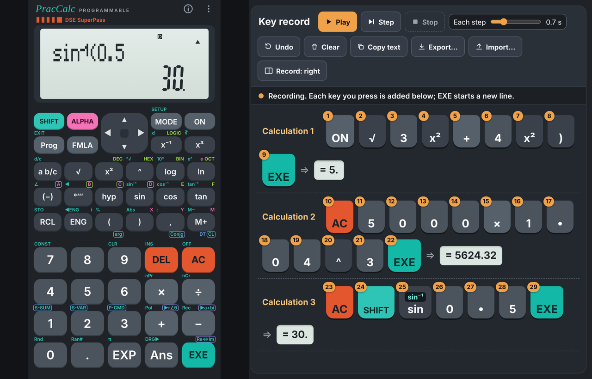
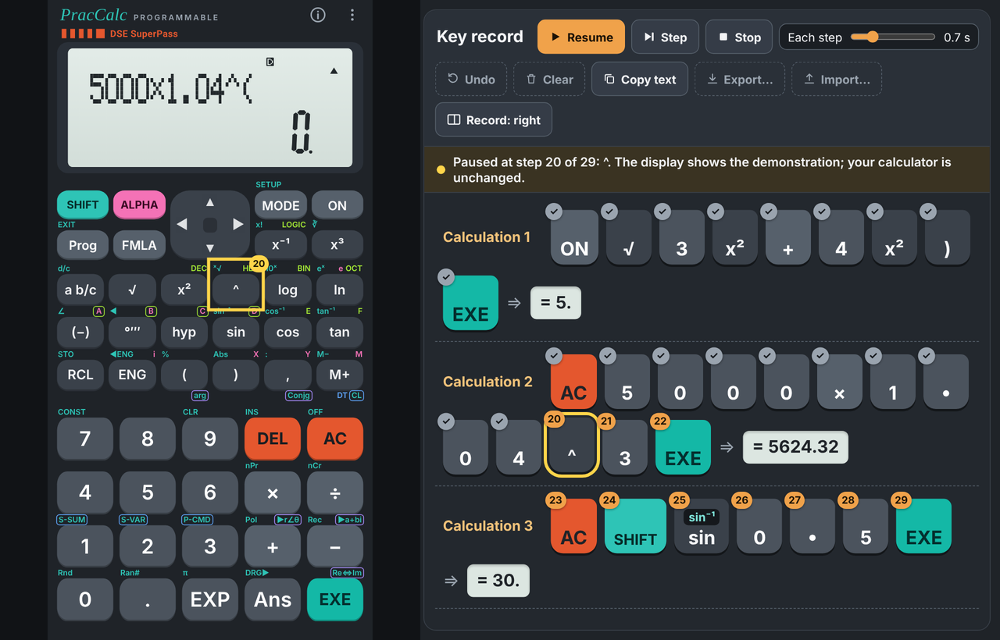
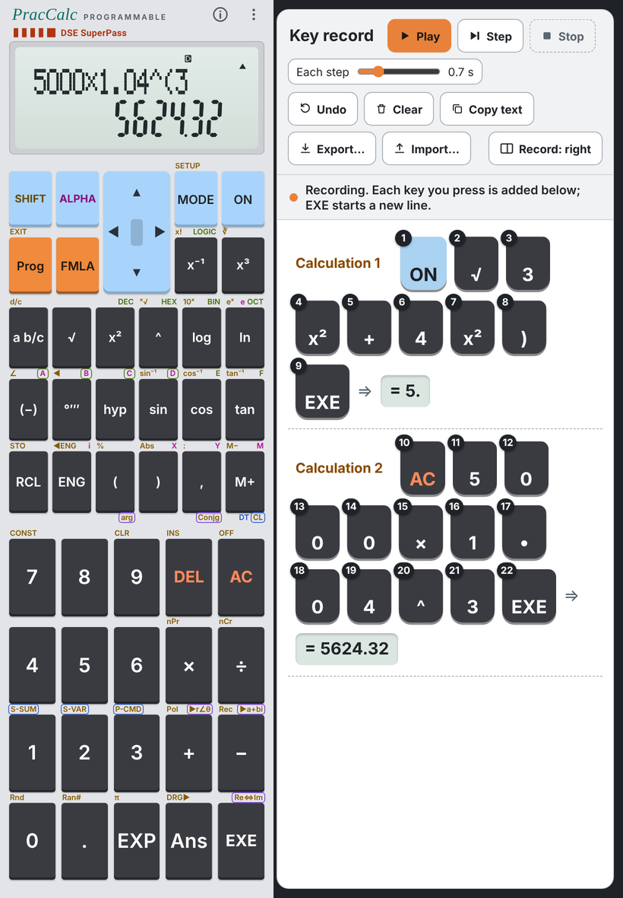

# PracCalc — Teacher edition

PracCalc (練機) is the DSE practice calculator (DSE練習計數機), called Sci-50 programmable until November 2026.

**Show calculator key steps to your class, replay them, and save them for next time.**

**Open it:** https://teach.pwc.hk

The same two-line programmable calculator as the [student version](https://myturtlelab.github.io/sci50-html/), with a **key record** beside it for the projector.

## Screenshots

*Every key you press is recorded beside the calculator, one line per calculation, with the answer the display shows.*

*Replay for the class: the key being pressed lights up on the calculator and in the record. Your own calculator is not changed.*

*The light theme, on a narrower window.*

## What it is for

- **Teach the key sequence, not only the answer.** Every key you press appears beside the calculator as a key cap with a step number. A key used after SHIFT or ALPHA shows its other function above it (for example sin⁻¹), and a menu choice shows its name (for example COMP).
- **One line per calculation.** EXE starts a new line, and each line ends with the result the display shows, for example `= 594.`
- **Replay for the class.** Play repeats the steps on the calculator: the key being pressed lights up with its step number, and so does its key cap in the record. Pause, Step and Stop; 0.2 to 2.5 seconds per step (0.7 s at first).
- **Fix a slip.** Undo removes the last key and puts the calculator back as it was before it.
- **Keep and share lessons.** Export saves the demonstration as a `.json` file; Import opens it again later, on any computer. The file is checked before anything changes, and your own calculator's memory and programs are never overwritten.
- **Paste into a worksheet.** Copy text gives the steps as plain text, for example `Calculation 2: [SHIFT] [sin⁻¹] [0] [.] [5] [EXE]  ⇒ = 30.`
- **Ready-made key-in steps for the 12 DSE programs.** Download a file, Import it and press Play: no need to key a long program into a real calculator in front of the class. See [Ready-made demonstrations](#ready-made-demonstrations-the-12-dse-programs).

## Use it

1. Type teach.pwc.hk in Chrome or Edge on the classroom computer. The key record is open from the start.
2. Press keys on the calculator, or type on the computer keyboard (press **?** for the key list).
3. Press **Play** to show the steps again.

| Computer key | Action |
| --- | --- |
| F8 | Hide or show the key record (or the **Hide [F8]** button; the **Key record [F8]** tab at the top right brings it back) |
| F9 | Play / Pause |
| Shift+F9 | Stop |
| Ctrl+→ | Step |
| Ctrl+Z | Undo the last key |

Menu (⋮) → **Teacher demonstration** lists every action. The **(i)** button beside the menu shows the notice and the version.

**A− / A+** in the record make the step text smaller or larger (70 % to 180 %).

The key record needs a window at least 600 pixels wide (a computer, or a tablet held sideways). **Record: right / below** moves it under the calculator.

## Ready-made demonstrations: the 12 DSE programs

The [demos](demos/) folder holds one demonstration file for each of the 12 DSE programs in PracCalc's Program Library (P1 to P12). Each file shows every key to type the program into P1, then runs it once with the Program Library's worked example. The keys are the same as the Program Library's Key-in instructions.

1. Download a file, or all 12 in one zip: [PracCalc DSE programs_key-in demos_v1.zip](demos/PracCalc%20DSE%20programs_key-in%20demos_v1.zip).
2. Open https://teach.pwc.hk, press **Import…**, choose the file, then **Load demonstration**.
3. Press **Play**, or **Step** one key at a time.

The demonstration starts from an empty program memory and a cleared screen. Your own calculator's memory and programs stay as they are. Play time is at the starting speed of 0.7 s a step; at 0.2 s a step it is under a third of that.

| Program | File | Steps | Play time | Answers of the worked example |
| --- | --- | --- | --- | --- |
| P1 | [Quadratic: Vertex, Optimum and Roots](demos/PracCalc%20P01%20Quadratic_key-in%20demo_v1.json) | 124 | about 1.5 min | −1, −16, 64, 3, −5 |
| P2 | [Simultaneous Linear Equations in Two Unknowns](demos/PracCalc%20P02%20Linear%20equations_key-in%20demo_v1.json) | 113 | about 1.5 min | 2, −1 |
| P3 | [Cubic Equations](demos/PracCalc%20P03%20Cubic%20equations_key-in%20demo_v1.json) | 734 | about 8.5 min | −1, −2, −3 |
| P4 | [Centre and Radius of a Circle](demos/PracCalc%20P04%20Circle%20centre%20and%20radius_key-in%20demo_v1.json) | 78 | under 1 min | −2, 4, 4.123105626 |
| P5 | [Intersection Points of a Straight Line and a Circle](demos/PracCalc%20P05%20Line%20and%20circle_key-in%20demo_v1.json) | 282 | about 3.5 min | 5, 5, −2, 6 |
| P6 | [Centre, Radius and Equation from Three Given Points](demos/PracCalc%20P06%20Circle%20from%20three%20points_key-in%20demo_v1.json) | 302 | about 3.5 min | 2, −2, 5, −4, 4, −17 |
| P7 | [Centres of a Triangle](demos/PracCalc%20P07%20Triangle%20centres_key-in%20demo_v1.json) | 520 | about 6 min | 12, 3, 12, 4, 12, 16, 12, −3.5 |
| P8 | [Simultaneous Equations (Complex)](demos/PracCalc%20P08%20Complex%20linear%20equations_key-in%20demo_v1.json) | 121 | about 1.5 min | 1, 1 − i |
| P9 | [Intersections of a Line and a Circle (Complex)](demos/PracCalc%20P09%20Complex%20line%20and%20circle_key-in%20demo_v1.json) | 296 | about 3.5 min | 5 + 3.535533906i, 5 − 3.535533906i, 5 − 3.535533906i, 5 + 3.535533906i |
| P10 | [Simultaneous Equations (Quadratic, Complex)](demos/PracCalc%20P10%20Complex%20quadratic%20equations_key-in%20demo_v1.json) | 189 | about 2 min | 3, 9, −1, 1 |
| P11 | [Intersections of Two Quadratic Curves (Complex)](demos/PracCalc%20P11%20Two%20quadratic%20curves_key-in%20demo_v1.json) | 394 | about 4.5 min | 5.8, 2.939387691i, 5.8, −2.939387691i |
| P12 | [Simultaneous Equations and Line-Circle (Combined)](demos/PracCalc%20P12%20Combined%20equations_key-in%20demo_v1.json) | 313 | about 3.5 min | −2, 6, 5, 5 |

When an answer is complex (P8, P9 and P11), the display shows its real part first; the demonstration then presses SHIFT EXE (Re⇔Im) to show the imaginary part, and SHIFT EXE again to go back.

Made with PracCalc 0.3.54 and teacher edition 0.1.9. If a later version would show a different answer, the Import preview says so before anything changes.

## Online only

The teacher edition runs only from its website, with an internet connection. A downloaded copy shows a notice instead.
**For offline use, please use the student version:** https://myturtlelab.github.io/sci50-html/ (it can be installed, or downloaded as `sci50.html`).

## Privacy

No sign-up, no ads, no tracking. Opening the page is a request to GitHub Pages, which logs visitors' IP addresses for security. After that the calculator makes no network request. The key record and your settings stay in your browser; a demonstration file goes only where you save it.

## Support the project

PracCalc is free. If it helps your lessons, consider buying me a coffee.

## Disclaimer

PracCalc is provided free of charge and "as is". It is not an examination-approved calculator and must not be used where only approved calculators are allowed. It is not affiliated with or endorsed by any calculator maker or examination authority.

## Licence

© 2026 Neo Time Consulting. All rights reserved. See [LICENSE.md](LICENSE.md).
